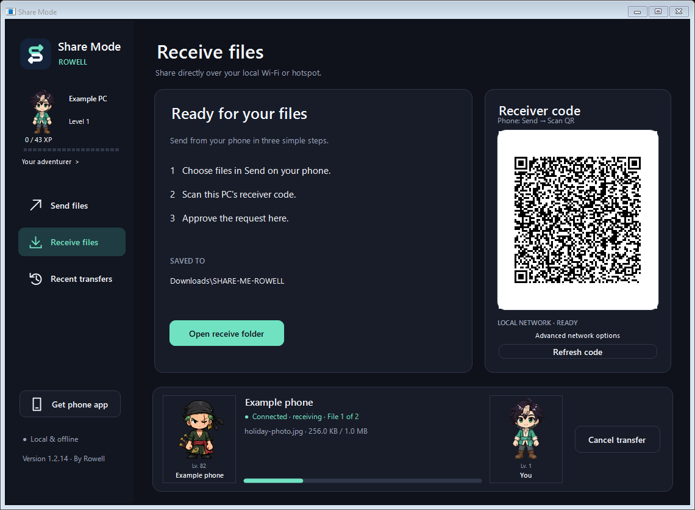

# Share Mode

Lightweight local file sharing for Android and Windows, by Rowell. Send photos, videos, installed Android apps and other files over the same Wi-Fi or an offline hotspot. No account or cloud upload is required.

**Preview: Windows 1.2.14 · Android 1.2.7**
Android 10+ · Windows 10/11, 64-bit

## Downloads

- [Android APK 1.2.7](https://github.com/Dling11/share-me-rowell/releases/download/v1.2.14/Share-Mode-1.2.7.apk)
- [Windows portable ZIP 1.2.14](https://github.com/Dling11/share-me-rowell/releases/download/v1.2.14/Share-Mode-Windows-1.2.14.zip)
- [Android ZIP with instructions](https://github.com/Dling11/share-me-rowell/releases/download/v1.2.14/Share-Mode-Android-1.2.7.zip)
- [Release notes](https://github.com/Dling11/share-me-rowell/releases/tag/v1.2.14) · [Checksums](https://github.com/Dling11/share-me-rowell/releases/download/v1.2.14/SHA256SUMS.txt)

Install the APK over your existing app. On Windows, extract the ZIP and open Share-Mode.exe; keep QRCoder.dll and the Android folder beside it. Your existing files, history and progress are retained. The Windows package includes the same Android APK for its local download QR.

## What's new

- Android: share from the system Share menu, choose installed apps and resume interrupted transfers.
- Both platforms: left/right transfer avatars with tap animations, saved avatar profiles, a character collection and XP earned from verified new transfers. Sharing features stay available at every level.
- Windows: a clearer desktop layout, sharper previews and optional character mastery skills. Zoro's idle-to-skill size transition still needs polish.

[Full changes](docs/RELEASE-1.2.14.md) · [Privacy](docs/PRIVACY.md)

## Screenshots

Screenshots use example profiles/files. Preview QR codes do not connect to a real device.

## Send files

1. Connect both devices to the same Wi-Fi or hotspot. Open **Receive** on the receiving device.
2. On the sender, choose files or **Send apps**. Android can also send files through **Share → Share Mode**.
3. Choose a nearby receiver or scan its QR. Compare the transfer code and approve the files.
4. Received files appear in Downloads/SHARE-ME-ROWELL. Resend the same files after reconnecting to resume an interrupted transfer.

Without a router, Android can create an offline hotspot; the other phone scans its QR to join. Bluetooth remains optional through Android system sharing. App sharing copies installer files, not app accounts, private data or saves.

Progress is local to each device. Repeated or renamed copies of the same verified file do not earn XP again. Older versions can connect through QR; update both devices for the newest interface and features.

## Build and support

[Build instructions](docs/BUILD.md) · [Validation](docs/TESTING.md) · [Play release checklist](docs/PLAY-RELEASE.md) · [Older releases](https://github.com/Dling11/share-me-rowell/releases)

Original code is MIT licensed. Third-party notices are included. The repository name, Android package, signing identity and existing data paths retain the earlier Share-Me-Rowell identifiers for compatibility.
