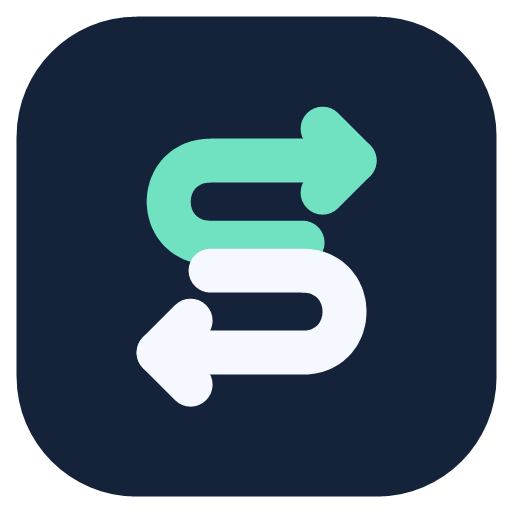
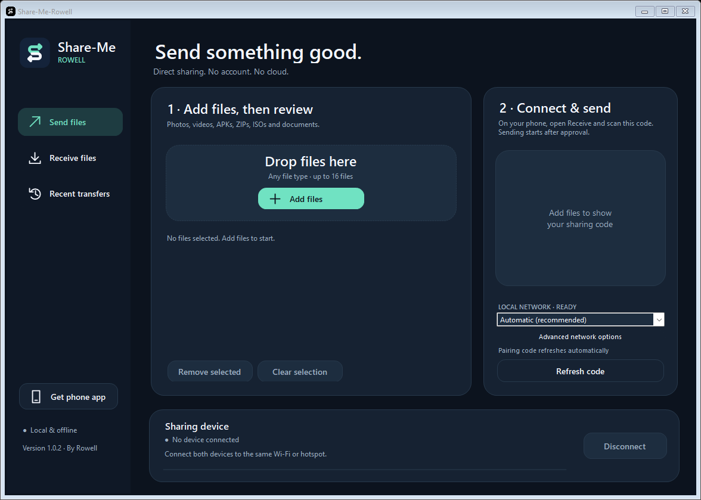

# Share-Me-Rowell

Offline file sharing for **Android and Windows**, by Rowell. Send APKs, ISOs, ZIPs, photos, videos and other files over the same Wi-Fi or a phone hotspot. No account or cloud service is needed.

**[Download Android APK](https://github.com/Dling11/share-me-rowell/releases/download/v1.0.1-r1/Share-Me-Rowell-1.0.1.apk)** · **[Download Windows ZIP](https://github.com/Dling11/share-me-rowell/releases/download/v1.0.1-r1/Share-Me-Rowell-Windows-1.0.1.zip)** · [All downloads](https://github.com/Dling11/share-me-rowell/releases/tag/v1.0.1-r1)

Android 10+ · Windows 10/11, 64-bit · **Preview release: real-phone testing is pending.**

A dark navy interface with mint accents, clear Send/Receive actions and a matching app icon on Android and Windows.

## Downloads

| Device | Download |
| --- | --- |
| Android 10+ | [Installable APK](https://github.com/Dling11/share-me-rowell/releases/download/v1.0.1-r1/Share-Me-Rowell-1.0.1.apk) |
| Android, with instructions | [Android ZIP](https://github.com/Dling11/share-me-rowell/releases/download/v1.0.1-r1/Share-Me-Rowell-Android-1.0.1.zip) |
| Windows 10/11, 64-bit | [Portable Windows ZIP](https://github.com/Dling11/share-me-rowell/releases/download/v1.0.1-r1/Share-Me-Rowell-Windows-1.0.1.zip) |
| Both platforms | [Complete package](https://github.com/Dling11/share-me-rowell/releases/download/v1.0.1-r1/Share-Me-Rowell-Complete-1.0.1.zip) |

Use these release assets to install the apps. GitHub's **Source code (zip)** is for developers. Checksums, instructions and validation status accompany the packages. Each ZIP has one outer folder to keep its contents together. The Windows ZIP also includes the exact Android APK for its local download QR.

## Quick start

1. **Install:** on Android, download and tap the APK; approve installation from your browser/file manager if asked. On Windows, extract the ZIP, open its **Share-Me-Rowell** folder, then open **Share-Me-Rowell.exe**.
2. **Connect:** put both devices on the same Wi-Fi/router or phone hotspot. No USB cable is needed. A normal Wi-Fi/hotspot transfer does not need internet access.
3. **Choose:** open **Send → Choose files** on the sender and **Receive** on the receiver. On Windows these are **Send files** and **Receive files**.
4. **Pair:** show a sender or receiver code on one device, then scan it from the opposite screen on the phone. For a PC transfer, always scan the PC's code with the phone.
5. **Approve:** accept the prompts and wait for **Transfer complete**. Received files are in **Downloads/SHARE-ME-ROWELL**.

If the other phone does not have the app yet, download the APK above, or use **Home → Share the app** to share this installer. Detailed direction-specific steps follow.

## PC → phone

1. Extract the Windows ZIP, open the **Share-Me-Rowell** folder, then open **Share-Me-Rowell.exe**. Keep `QRCoder.dll` beside it.
2. Connect the PC and phone to the same Wi-Fi. A PC on Ethernet also works when connected to the same router.
3. On the PC, select **Send files → Choose files**, or drag files into the list. File checksums are prepared first.
4. On the phone, open Share-Me-Rowell → **Receive → Scan sender's code**. Scan the PC's QR code.
5. Approve the request on the PC, then accept the files on the phone. Completed files appear in **Downloads/SHARE-ME-ROWELL**.

For the first phone installation, the Windows app's **Get the phone app** button displays a local download QR. Scan it with the phone's normal camera and download the APK. Alternatively, copy the standalone APK to the phone. Android handles installation and its usual approval.

## Phone → PC

1. On the PC, select **Receive files**.
2. On the phone, select **Send → Choose files → Scan receiver's code**.
3. Scan the PC's code and approve the request on the PC.
4. Files appear in the PC's **Downloads\SHARE-ME-ROWELL** folder. **Open receive folder** takes you there.

## Phone → phone, including offline hotspots

1. Install the app on both phones.
2. Use the same Wi-Fi, or choose **Create offline hotspot** in Send/Receive. Allow Android's nearby Wi-Fi permission. Older Android versions also require Location access and Location enabled for hotspot operations.
3. The sender chooses files. One phone shows its sender/receiver code and the other scans it from the opposite screen.
4. For an app-created hotspot, the QR includes its connection details. Android may ask to join the network. You can also join it manually using the displayed name/password.
5. Accept the files and keep the transfer notification active until completion.

Mobile data and internet access are unnecessary for local transfers. Both devices need a usable local IPv4 connection. Guest Wi-Fi/client isolation, VPN routing or a firewall may block nearby devices. If hotspot creation is unavailable on a phone, use its normal Hotspot settings, then show a fresh code.

## Bluetooth and sharing the installer

**Android sharing · choose Bluetooth** opens Android's built-in sharing screen for the selected files. Select Bluetooth and accept on the other device. Bluetooth pairing, receiving and progress are handled by Android/Windows, outside this app's Wi-Fi transfer screen.

**Home → Share the app → Share APK · Bluetooth / other apps** shares this app's own installer. **Show local download QR** offers that installer to a browser on the same Wi-Fi/hotspot. The local installer page serves only this app's public APK over HTTP; the regular file-transfer channel uses TLS with the certificate identity pinned by the pairing QR.

## Device status and Disconnect

After pairing, a device card shows the other phone/PC's name and the current stage: **Connecting**, **Waiting for approval**, **Sending/Receiving** or **Verifying**. Windows shows this card at the bottom; Android shows it above the current page's actions.

**Disconnect** stops the current connection after confirmation. Unfinished files remain available to resume when you scan and send them again. On Android, it keeps your local hotspot running; **Stop sharing & hotspot** closes that too.

Each connection lasts for one batch. The card changes to **Finished · disconnected**, **Declined · disconnected**, **Disconnected** or **Connection ended** afterward. A new scan starts another batch; the app does not keep an idle connection open. Pairing uses QR codes, without automatic nearby-device discovery. Internet transfers between different locations are not included.

## Progress, retries and received APKs

- Files stream in small buffers; multi-gigabyte files are not loaded into memory. Sizes use 64-bit integers. Up to 16 files can be selected per batch; the implemented per-file protocol limit is 1 TB, subject to free storage and device/filesystem limits.
- Incoming batches ask for approval. Files are SHA256-verified before being marked complete. Existing files are preserved by choosing a unique destination name.
- After a connection drops, reconnect and send the same files again to resume compatible partial downloads. Pairing codes expire after ten minutes; show a new code as needed. Restarting a transfer does not require the old pairing code.
- **Stop sharing** closes the listener/connections and any hotspot created by the app. Android shows an ongoing notification while sharing is active. Device power management can still interrupt long transfers; retry/resume is available.
- **Home → Remove unfinished downloads** frees Android storage used by interrupted transfers. Completed downloads remain. Windows partial files are in the receive folder's `.shareme-parts` directory.
- Open **History → Install APK** for a received APK. If Android asks, allow installation from Share-Me-Rowell, return and tap Install APK again. Nothing installs automatically.
- Direct folder selection, automatic nearby-device discovery and an integrated Bluetooth progress engine are not included in 1.0.1. ZIP a folder before sending it.

## Windows connection help

Keep both devices on your trusted local network. If Windows Firewall asks, allow the app for that network. If the phone still times out, `Allow-Local-Network.ps1` in the Windows ZIP can add a rule limited to this executable, TCP ports 48290/48291 and local-subnet peers. It requires administrator rights. It does not disable the firewall.

## Source and building

- `android/`: Kotlin + Jetpack Compose app and its tests.
- `windows/`: C#/.NET Framework 4.8 companion, compiled using Windows' installed compiler.
- `scripts/`: repeatable build/package commands.
- `tests/`: protocol/interoperability checks using isolated test files.

See [build instructions](docs/BUILD.md) and [protocol notes](docs/PROTOCOL.md). Signing keys, caches, received files and build outputs are excluded from source history. Keep the Android signing key private and backed up to retain update compatibility.

Version 1.0.1 passed 18 Android JVM tests, Android lint with no errors, 18 Windows loopback transfer/installer checks, and decoding of the displayed Windows QR. These include completion/decline status, cancelling pending approval, disconnect/resume and protection against late status updates. **Real-phone testing is pending**: Android UI, Wi-Fi/hotspot interoperability, Bluetooth and background behavior still need device checks. Multi-gigabyte throughput has not been benchmarked; the size test verifies 64-bit metadata handling.

Original Share-Me-Rowell application code is MIT-licensed. It is an independent project. Third-party libraries and their licences are listed in [THIRD_PARTY_NOTICES.md](THIRD_PARTY_NOTICES.md).
