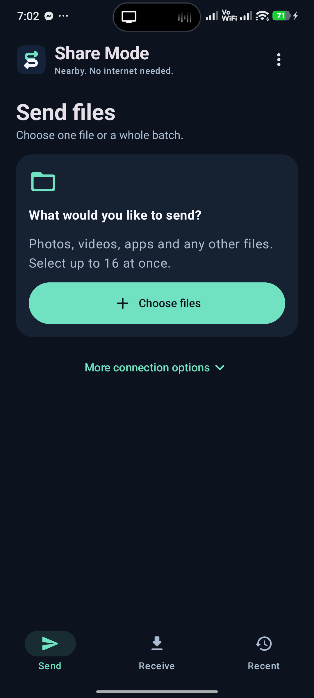
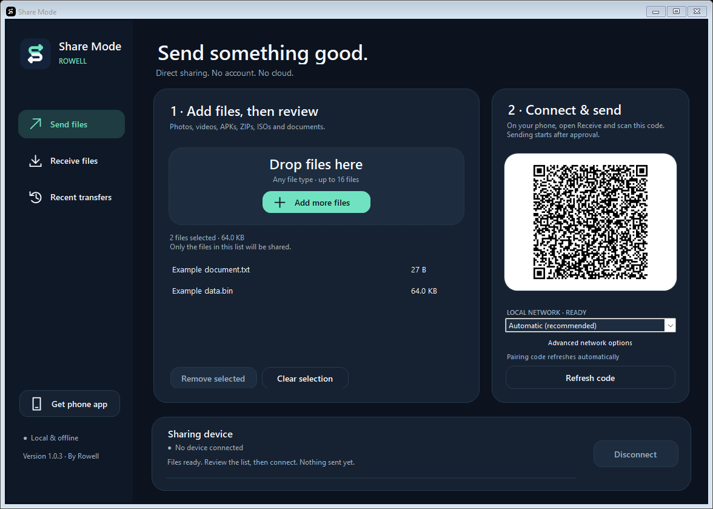

# Share Mode

Local file sharing for **Android and Windows**, by Rowell. Send photos, videos, APKs, ISOs, ZIPs and other files on the same Wi-Fi or a phone hotspot. No account, cloud or internet connection is required.

Previously named Share-Me-Rowell. The source folder, repository URL, pairing format, Android package/signing identity and existing download/history locations are retained for compatibility.

Android 10+ · Windows 10/11, 64-bit · **1.0.3 preview release**

## Downloads

Download Share Mode 1.0.3:

- [Android APK](https://github.com/Dling11/share-me-rowell/releases/download/v1.0.3/Share-Mode-1.0.3.apk)
- [Android ZIP with instructions](https://github.com/Dling11/share-me-rowell/releases/download/v1.0.3/Share-Mode-Android-1.0.3.zip)
- [Windows portable ZIP](https://github.com/Dling11/share-me-rowell/releases/download/v1.0.3/Share-Mode-Windows-1.0.3.zip)
- [Complete package](https://github.com/Dling11/share-me-rowell/releases/download/v1.0.3/Share-Mode-Complete-1.0.3.zip)
- [Checksums](https://github.com/Dling11/share-me-rowell/releases/download/v1.0.3/SHA256SUMS.txt) and [validation metadata](https://github.com/Dling11/share-me-rowell/releases/download/v1.0.3/VERSION.json)

The [previous public 1.0.2 release](https://github.com/Dling11/share-me-rowell/releases/tag/v1.0.2) still uses the old name and does not contain the 1.0.3 changes. GitHub's Source code ZIP is for development, not installation.

Each download ZIP has one outer folder. The Windows ZIP includes the same Android APK for its local download QR. Keep `QRCoder.dll` beside `Share-Mode.exe`.

## Screenshots

The Android Send screen, captured from the installed 1.0.3 app:

The Windows app and selected-file review:

Windows screenshots use example files and an isolated loopback pairing session. Their QR codes do not connect to a real sharing device.

## Phone → phone

1. Install the APK on both phones. It updates the existing app without uninstalling it.
2. Put the phones on the same Wi-Fi. Without a router, open **Receive → No Wi-Fi? Create a hotspot** on the receiving phone.
3. On the sending phone, open **Send → Choose files**. Select one file or up to 16 together.
4. Review the filenames, sizes and previews. **Add more files**, remove a row or **Clear all** as needed. Tap a row for the full filename and an Open action.
5. Tap **Scan receiver to send** and scan the receiving phone's code. For an app-created hotspot, approve Android's request to join the named network.
6. The receiving phone reviews and approves the batch. Progress and the current filename stay at the top on all tabs.

No mobile data is needed. On Android 13+, allow Nearby Wi-Fi access for hotspot creation/joining. On Android 10–12, allow Location and enable Location in Settings. You may also use the phone's normal Hotspot/Wi-Fi settings and refresh the receiver code after both phones connect.

The sender's **More connection options → Show sender code** remains available for reverse scanning. The receiving phone uses **Scan sender code · phone or PC**. These are alternatives to the main receiver-code flow.

## Phone ↔ PC

The **phone scans the PC's code** in both directions:

- **Phone → PC:** Windows: **Receive files**. Phone: **Send → Choose files → Scan receiver to send**.
- **PC → phone:** Windows: **Send files → Add files** (or drag files). Phone: **Receive → Scan sender code · phone or PC**.

Use the same Wi-Fi/router/hotspot. Ethernet on the same router also works for the PC. Review and approve requests. Files arrive in **Downloads/SHARE-ME-ROWELL**, the existing folder name on both platforms.

The Windows **Get phone app** button offers the included Android installer through a local QR. Scan it with the phone's normal camera, download the APK and follow Android's installation prompt.

## Simpler mobile controls

There are three tabs: **Send**, **Receive** and **Recent**. The selected files come first; the main scan/send button stays available below the list. Image thumbnails use bounded decoding, supported video/document thumbnails come from Android, and other files show a type label. Full filenames are available in file details; arbitrary files are not rendered inside the app.

The top-right menu contains **Share the app**, **Wi-Fi settings**, **Paste pairing link**, **Stop sharing & hotspot**, unfinished-download cleanup and About.

Bluetooth is **optional**. **More connection options → Android sharing · Bluetooth optional** opens Android's share sheet for selected files. **Share the app → Share installer via Android** does the same for this app's APK. Android handles Bluetooth pairing, receiving and progress; Bluetooth is not required for Wi-Fi/hotspot transfers.

## Connection status and cancellation

Each connection lasts for one batch. The transfer banner shows the device, current file, file count, bytes and connection stage. **Cancel** can stop file preparation or cancel an active transfer after confirmation. Removing selected files preserves the originals.

**Stop sharing & hotspot** also closes a hotspot created by the app. A finished, declined or interrupted connection is shown as a terminal result. Scan again for a new batch. There is no permanent idle connection or automatic nearby-device discovery.

Pairing codes expire after ten minutes. **Refresh code** generates a new one. Idle codes refresh when local addresses change. Guest Wi-Fi/client isolation, VPN routing or firewalls may block local communication; use a trusted router or a phone hotspot. Subnet hints suggest a possible mismatch and do not claim to identify Wi-Fi network names.

## Integrity, resume and limits

- Files stream in small buffers. Up to **16 files per batch**, **1 TB per file** at protocol level, subject to device/storage limits.
- Incoming files require approval. SHA256 verification finishes before completion is reported. Existing files are preserved.
- After interruption, reconnect and send the same files to resume compatible partial downloads.
- Completed transfers appear in **Recent**. Received APKs install only through Android's explicit installation approval.
- **Remove unfinished downloads** frees interrupted Android downloads while keeping completed files. Windows partials remain in `.shareme-parts` inside the receive folder.
- ZIP a folder before sending it. Direct folder selection, automatic discovery, long-distance internet transfers and integrated Bluetooth progress are not implemented.

## Windows connection help

If Windows Firewall asks, allow the app on your trusted local network. `Allow-Local-Network.ps1` can add a rule limited to `Share-Mode.exe`, TCP ports 48290/48291 and local-subnet peers; it needs administrator rights and does not disable the firewall.

Automatic network selection avoids WSL/Docker adapters. Those adapters are shown only under **Advanced network options**. The Android client tries alternative QR addresses, prioritizes addresses on its local network and explains refusal, timeout, security or peer rejection errors.

## Development and validation

- `android/`: Kotlin and Jetpack Compose.
- `windows/`: C# WinForms on .NET Framework 4.8.
- `scripts/`: project-local builds, checks and packages.
- `tests/`: isolated protocol and Windows UI checks.

Read [BUILD.md](docs/BUILD.md), [PROTOCOL.md](docs/PROTOCOL.md) and [TESTING.md](docs/TESTING.md). The Android build uses project-local Windows tools/cache and does not start or change Docker or any Tri/MH4 project.

Preserve `.local/signing/shareme.jks` and its private password file. Package `com.rowell.shareme` and its signing certificate remain stable across the rename. Do not put keys, passwords, runtime data or build caches into source history or downloads. Builds and packaging do not commit, push or publish.

Original application code is MIT-licensed. This independent project is not affiliated with SHAREit or Xiaomi ShareMe. See [third-party notices](THIRD_PARTY_NOTICES.md).
